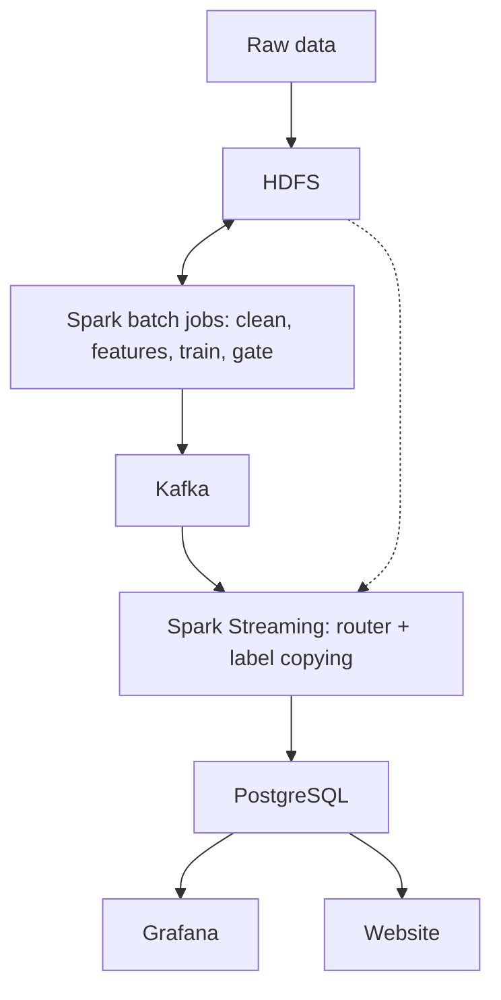

# DDoS Detection with Familiarity Routing

A DDoS detection pipeline built on Hadoop HDFS, Apache Spark and Apache Kafka, using the CIC-DDoS2019 dataset.

## How it works

Models trained on one day of network traffic often make mistakes on the next. Most of those mistakes happen on traffic that looks unfamiliar compared with what the model was trained on. This project handles that in two ways:

1. **Familiarity router.** Each connection is checked against the training data to see how familiar it looks. A fast model answers familiar traffic. Unfamiliar traffic goes to a stronger random forest model.
2. **Label copying.** When an unfamiliar connection closely matches one that already has a known label, it reuses that label. New labels are requested over Kafka only when needed.

Nothing is retrained.

The data flows through the system like this:



## Guide

### Requirements

- Docker
- sbt
- The [CIC-DDoS2019 dataset](https://www.unb.ca/cic/datasets/ddos-2019.html)

### 1. Set up

```bash
cp .env.example .env
docker compose up -d
cd spark && sbt -batch assembly && cd ..
```

In `.env`, set your own passwords.

### 2. Load the data

The day 1 CSV goes in `/data/raw/01-12`. The day 2 JSON goes in `/data/raw/03-11-json`.

```bash
docker cp ./raw namenode:/tmp/raw && docker exec namenode hdfs dfs -put /tmp/raw /data/raw
```

### 3. Run the batch jobs

Run this command once for each class below, in order:

```bash
docker exec spark-master /opt/spark/bin/spark-submit --class <CLASS> /opt/jobs/ddos-detection.jar
```

- `ddos.ingest.BuildBronze`
- `ddos.ingest.BuildSilver`
- `ddos.ingest.BuildFeatures`
- `ddos.train.TrainModels`
- `ddos.train.TrainModelsWhole`
- `ddos.stream.LoadReports`
- `ddos.learn.Gate`

### 4. Start the live stream

```bash
bash scripts/demo.sh
```

Open the website at http://localhost:8090 or the Grafana dashboards at http://localhost:3000.

The website's assistant also needs [Ollama](https://ollama.com) running with a Gemma model.

### 5. Stop

```bash
docker exec spark-master pkill -f LiveScorer
docker compose stop
```
