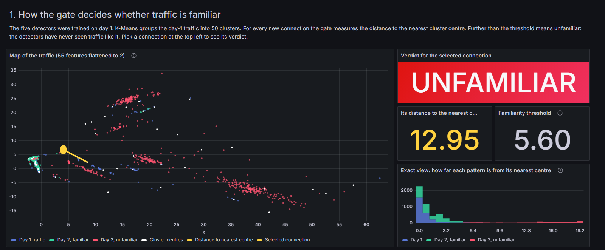
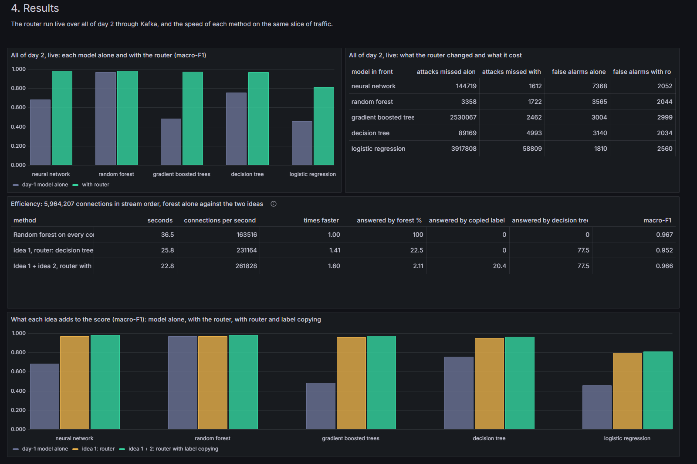
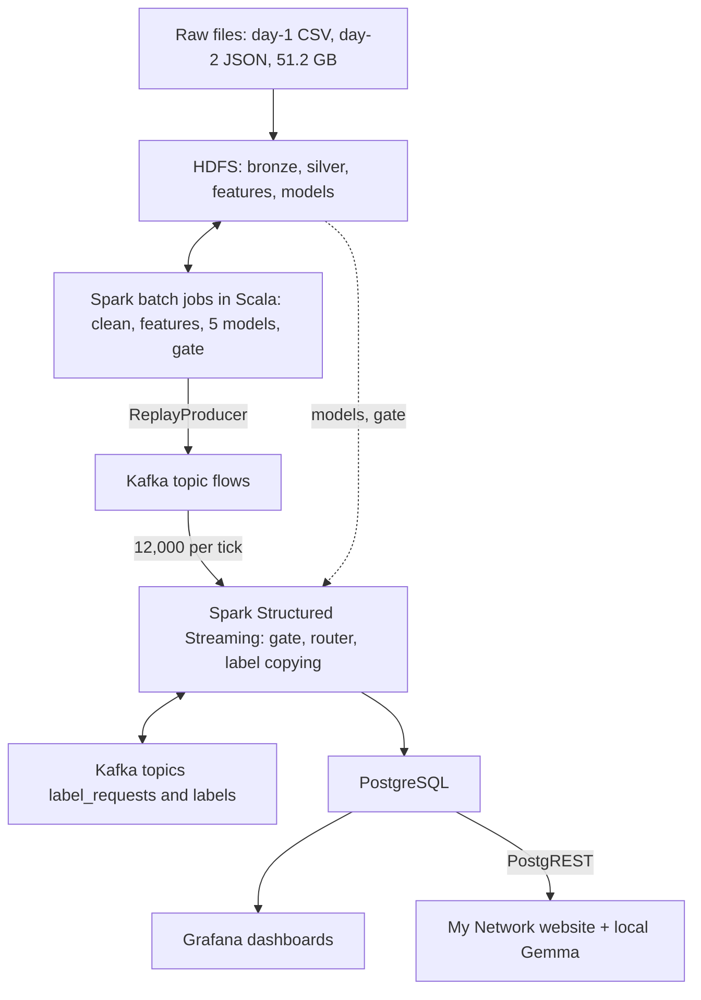
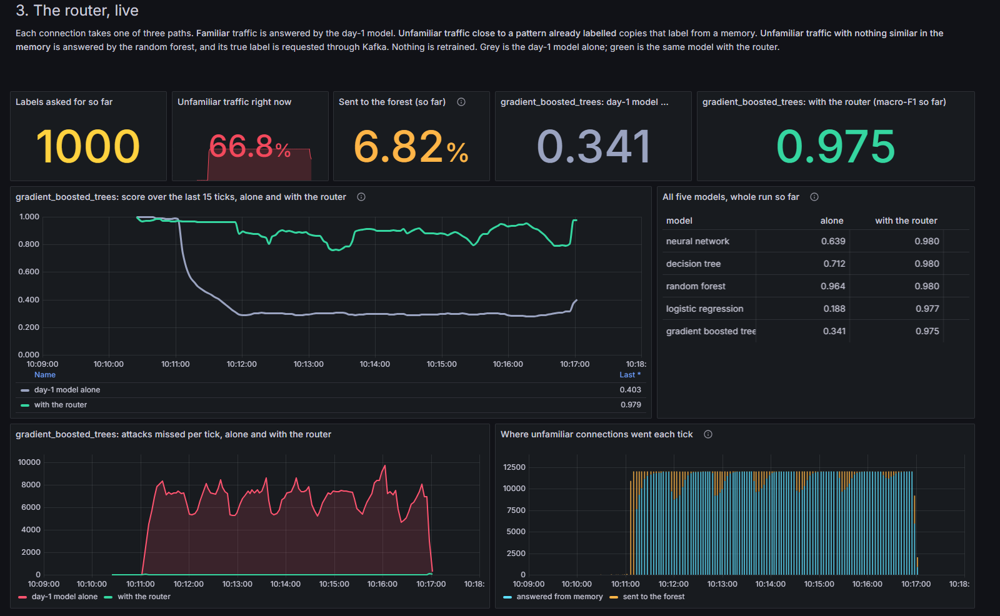

# Familiarity routing with label copying for DDoS detection

A big-data DDoS detection pipeline on **Hadoop HDFS, Apache Spark and Apache Kafka**, built on the
CSE-CIC-DDoS2019 dataset (51.2 GB, 70.4 million flow records).

Team 17, 23AID302 Big Data Analytics, Amrita Vishwa Vidyapeetham, Coimbatore

Report: [docs/report.pdf](docs/report.pdf) · Slides: [docs/presentation.pptx](docs/presentation.pptx)

## What the project does

We trained five Spark MLlib models on day 1 of CIC-DDoS2019 and tested them on day 2. On the same day
they score 0.89 to 0.98 macro-F1. On day 2, four of them fall to between 0.46 and 0.76, and only the
random forest holds up, at 0.967.

Looking at where they fail, 96 to 99.9% of every model's day-2 mistakes are in the 22.6% of traffic
that is far from the day-1 data (distance to the nearest of 50 K-Means centres). We use that in two ways:

1. **Familiarity router.** A cheap day-1 model answers familiar traffic; unfamiliar traffic goes to
   the random forest.
2. **Label copying.** An unfamiliar connection that is almost identical to one we already have a true
   label for takes that label. New labels are requested through Kafka only where the forest had to answer.

Nothing is retrained.



## Results

On 5,964,207 day-2 connections replayed in time order (macro-F1):

| Model in front | Alone | Router | Router + label copying |
|---|---|---|---|
| Logistic regression | 0.458 | 0.798 | 0.808 |
| Decision tree | 0.756 | 0.952 | 0.966 |
| Random forest | 0.967 | 0.967 | 0.981 |
| Gradient-boosted trees | 0.485 | 0.959 | 0.973 |
| Neural network | 0.685 | 0.967 | 0.982 |

Time for the model work on the same stream (six cores, decision tree in front):

| Method | Time | Sent to the forest | Speed |
|---|---|---|---|
| Random forest on everything | 36.5 s | 100% | 1.00× |
| Router | 25.8 s | 22.50% | 1.41× |
| Router + label copying | 22.8 s | 2.11% | 1.60× |

During the Syn flood the router with copying is 2.76× faster than the forest alone (3.06 s against 1.11 s
on 954,274 connections around the flood, with the label memory already filled). Live over the whole of day 2 (19,881,726 connections, 1,657 ticks), it used
1,000 labels and sent 1.48% of connections to the forest.

The measurements behind these numbers are in [logs/EfficiencyCheck.txt](logs/EfficiencyCheck.txt),
[logs/ThroughputCheck2.txt](logs/ThroughputCheck2.txt) and the other files in `logs/`.



## Architecture



Everything runs on one machine with Docker Compose (12 containers):

| Part | Version | Notes |
|---|---|---|
| HDFS | Hadoop 3.2.1 | 1 name node, 3 data nodes, 128 MB blocks, replication 1 |
| Spark | 3.5.5 standalone | 1 worker, 6 cores, 5 GB; 2 executors of 3 cores and 2,500 MB; history server |
| Kafka | 3.7.0, KRaft | topics `flows`, `label_requests`, `labels` |
| PostgreSQL | 16 | result tables |
| Grafana | 11.2 | three dashboards |
| PostgREST, nginx | | read-only API and the website |

## Repository layout

```
spark/src/main/scala/
  ddos/common/   Session, Schema, Rules, Metrics, Postgres
  ddos/ingest/   BuildBronze, BuildSilver, BuildFeatures
  ddos/train/    TrainModels, TrainModelsWhole, Evaluation
  ddos/learn/    Gate (idea 1), Memory (idea 2)
  ddos/stream/   ReplayProducer, LiveScorer, LoadReports
  ddos/test/     EfficiencyCheck, ThroughputCheck, Day2Check, GateMap, Sample
  org/apache/spark/ml/tree/DecisionPath   feature reasons for each decision
infra/           Spark config, Grafana dashboards, Hadoop env, website SQL
scripts/         demo.sh (start everything), run-cleaning.sh, start.sh
web/             the My Network website
docs/            report, slides, screenshots
logs/            output of the runs the results come from
```

## Running it

You need Docker (with about 11 GB of memory for it), sbt, and the CIC-DDoS2019 dataset from
<https://www.unb.ca/cic/datasets/ddos-2019.html>. The dataset is not in this repository.

**1. Passwords.** Copy the example file and set your own:

```bash
cp .env.example .env
```

**2. Start the cluster and build the jar.**

```bash
docker compose up -d
```

```bash
cd spark && sbt -batch assembly && cd ..
```

**3. Put the data in HDFS.** Day 1 CSV goes to `/data/raw/01-12`, day 2 JSON lines to
`/data/raw/03-11-json` (we converted day 2 from the original CSV to nested JSON to have two formats;
the field names it expects are in `Schema.scala`). For example:

```bash
docker cp ./raw namenode:/tmp/raw && docker exec namenode hdfs dfs -put /tmp/raw /data/raw
```

**4. Run the batch jobs in order.** Each one is the same command with a different class:

```bash
docker exec spark-master /opt/spark/bin/spark-submit --class ddos.ingest.BuildBronze /opt/jobs/ddos-detection.jar
```

| Order | Class | Time on our laptop |
|---|---|---|
| 1 | `ddos.ingest.BuildBronze` | 8.8 min |
| 2 | `ddos.ingest.BuildSilver` | 45.1 min |
| 3 | `ddos.ingest.BuildFeatures` | 11.2 min |
| 4 | `ddos.train.TrainModels` | tuning run |
| 5 | `ddos.train.TrainModelsWhole` | 102.7 min |
| 6 | `ddos.stream.LoadReports` | |
| 7 | `ddos.learn.Gate` | 0.6 min |

**5. Start the live stream.** This fills Kafka if it is empty, resets the label memory and starts the
live scorer:

```bash
bash scripts/demo.sh
```

Then open:

| Page | Address |
|---|---|
| My Network website | <http://localhost:8090> |
| Grafana: router | <http://localhost:3000/d/ddos-router> |
| Grafana: live detection | <http://localhost:3000/d/ddos-live> |
| Grafana: model lab | <http://localhost:3000/d/ddos-lab> |
| Spark job UI (while running) | <http://localhost:4040> |
| Spark history server | <http://localhost:18080> |
| HDFS | <http://localhost:9870> |

Stop the stream with `docker exec spark-master pkill -f LiveScorer`, and everything with
`docker compose stop`. The website's assistant needs [Ollama](https://ollama.com) running locally
with a Gemma model.



## Limitations

One dataset, captured in a testbed over two days. The labels used for copying come from the dataset
and stand in for a human analyst. Everything runs on one machine, so Kafka has one partition and HDFS
one replica. The live job scores every connection with all five models so the dashboards can compare
them; the speed figures come from `EfficiencyCheck`, which runs only the model each connection is
routed to. The system detects attacks; it does not block them.
